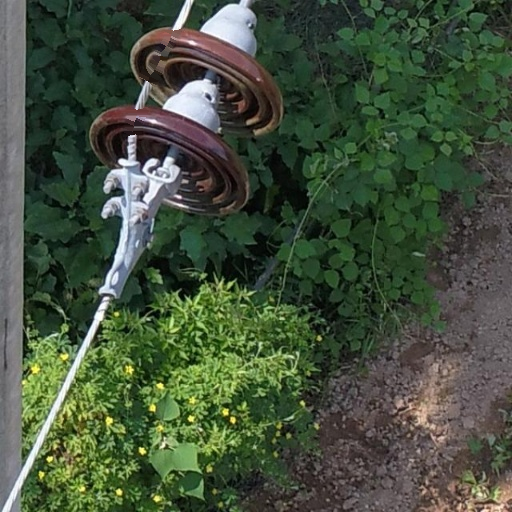
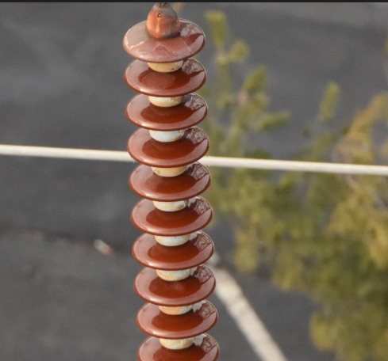

# 算法接入与验收说明

接入日期：2026-10-14。依据用户指定的 V1.2.0 使用说明 PDF（第 10、17、20 页）及两个 RAR 压缩包。正式项目目录为 `D:\Work_space\project\TransmissionLineDefectSystem`。

## 已接入的内容

PDF 文字列出 6 个算法名称，第 17 页下拉框另展示“逆光&曝光处理”和“雨天图像处理”，合计 8 个可辨认入口，现均可在“本地输电线路算法平台”中选择。第 10 页截图显示总计 9 条，但没有展示第二页的全部名称，因此不能确认未显示的第 9 项。原系统 `algorithm` 测试模板继续保留，不将其认定为缺失的正式算法。

| PDF 中的名称 | 当前实现与来源 |
| --- | --- |
| deeplabv3 | 新适配器；使用包内 ep020 / deeplabv3_plus.pth 原始权重，可切换其他已登记分割模型 |
| 去雨后增强处理 | 沿用系统已有真实图像处理代码；两个压缩包没有此源码 |
| 去雾恢复 | 沿用系统已有暗通道去雾代码；两个压缩包没有此源码 |
| 曝光校正与细节恢复 | 沿用系统已有曝光处理代码；两个压缩包没有此源码 |
| 电气设备缺陷检测模型算法 | 保留原 YOLO 定制实现及 best.pt；两个压缩包没有此源码或权重 |
| 电气设备语义分割模型算法 | 保留原完整模型 .pt 与算法，已有任务可继续使用 |
| 逆光&曝光处理 | 恢复该名称的入口，复用曝光校正与细节恢复；独立原版源码不在两包中 |
| 雨天图像处理 | 恢复该名称的入口，复用去雨后增强处理；独立原版源码不在两包中 |

另新增“语义增强”（ep025 权重推理）与“遮挡关系融合骨架”（分割、遮挡关系分析及图像补全）入口。当前列表共 11 个入口，包含上述 8 个、2 个新增入口以及 1 个测试模板；它们不是 11 种独立算法原理。

## 模型与源码来源

| 登记名称 | 文件与推理结构 | 类别说明 |
| --- | --- | --- |
| best.pt | 原系统定制 YOLO 检测模型 | 保留原模型，不替换 |
| 电气设备语义分割模型.pt | 原系统完整分割模型 | 原八类别配置 |
| deeplabv3_plus.pth | 包内 ep020 权重，DeepLabV3+ / MobileNetV2 | 背景、绝缘子、杆塔、导线、杆塔脚钉、销钉、悬垂线夹、防震锤 |
| 语义增强 | 包内 ep025 权重，DeepLabV3+ / MobileNetV2 | 与随包 predict.py 八类别配置一致 |
| last_epoch_weights.pth | 包内 DeepLabV3+ / Xception 权重 | 实际为七类别；缺少类别名称表，仅输出类别 0～6 |

两个包内 ep020 与 deeplabv3_plus.pth 共三处文件内容完全相同，只导入一份。包内 DeepLab、MobileNetV2 和 Xception 网络源码与项目已有文件逐字节一致，直接复用 `nets/`，避免重复网络代码。所有新 state_dict 均使用 `strict=True` 完整加载，不丢弃不匹配参数，也不使用随机分类头替代。

包内说明把 ep025 称为“双分支”训练模型，但提供的推理结构、参数键和尺寸与 MobileNetV2 版 DeepLabV3+ 一致。本次保留其独立训练权重，不推测或补造缺失的训练网络。

八类别名称以随包 `predict.py` 为依据。骨架包调色板注释中的类别顺序与该表冲突，未用颜色注释改写类别名称。七类别模型在得到训练类别表前不套用八类别名称，其输出统计会提示类别名称未提供；类别 0 也按 ID 统计，不擅自认定其为背景。由于背景类别尚未确认，该模型暂不用于遮挡补全，需先补充训练类别表。

## 系统接口与结果格式

入口均为 `algo/` 下同名 `.py` 文件，实现 `algorithm(zip_path: Path, ...) -> bytes`：接收图像 ZIP，返回结果 ZIP。注册参数与解释写入算法服务 `config.yaml`，模型写入 `model_config.yaml`。新算法共用 `algo_support/`，依赖原有 `nets/` 和登记模型；没有交互式 input、弹出图像窗口、硬编码数据目录或必须使用 CUDA 的限制。

模型选择与默认参数会由任务向导自动加载。在“本地输电线路算法平台”选择算法后，可使用以下配置：

```json
{"model_name": "deeplabv3_plus.pth", "overlay_alpha": 0.5, "device": "auto"}
```

选择“语义增强”时，默认 `model_name` 为“语义增强”；在 deeplabv3 入口选择七类别模型时改为 `last_epoch_weights.pth`。旧 deeplabv3 任务中的 `model_name: 电气设备语义分割模型.pt` 仍可运行。使用 `device: cuda` 时需要实际 CUDA 环境，否则会明确报错。

分割结果每张图片包含 `_pred.png` 类别 ID 掩膜、`_seg.png` 彩色分割图、`_overlay.png` 融合图、`_statistics.txt` 与 `_statistics.json`。统计按输出原图尺寸掩膜计算。

遮挡补全在上述结果基础上增加 `_filled_id.png`、`_filled_color.png`、`_filled_overlay.png`、`_added_mask.png`、`_reconstruct.png` 和 `_occlusion.json`。后者记录参数及掩膜变化像素数。原包的几何判定、形状先验、弧线桥接和三种纹理补全函数保留，支持 `nn_cover`、`shift` 与 `avg_soft`。重建图属于算法推断，不能视作原始图像中已经观察到的真实内容。

新入口支持 JPG、JPEG、PNG、BMP、TIF、TIFF；使用序号前缀区分同名输入。结果 ZIP 全部是顶层文件，适配业务后端的结果登记逻辑。中文路径使用 Pillow 读写，临时目录由接口自动清理。损坏图片、无图片 ZIP、非分割模型、无效参数和设备会明确失败。

## 运行验收

使用骨架包的“原图1.png”（512×512）和“原图2.png”（489×456），它们与 PDF 第 20 页展示的巡检图一致。本轮没有上传业务数据或创建业务检测任务，直接调用算法平台临时执行接口，并检查业务后端的列表中转接口。

| 检查 | 结果 |
| --- | --- |
| 11 个注册入口，逐个默认参数、双图批量执行 | 全部通过 |
| Xception 七类别权重、旧 deeplabv3 参数、中文嵌套目录同名图片、另外两种纹理补全模式 | 5 个附加成功用例通过 |
| 非分割模型、错误填充模式、未确认背景的遮挡模型、无输入图片、损坏图片 | 5 个预期失败用例通过 |
| ZIP 完整性、文件不重名、图像解码与尺寸、掩膜 ID 范围、统计像素一致性 | 通过 |
| 补全区域二值图与掩膜变化像素一致性 | 通过；两张样本分别变化 1343、14 像素 |
| 新 DeepLab 输出与随包原 predict.py 的分割图、融合图逐像素比较 | 两张图片完全一致 |
| 移植的几何与纹理函数与原源码的 AST 比较 | 完全一致 |
| 业务后端平台算法列表与模型列表 | 11 个入口、5 个模型均可读取 |
| 任务向导实际解析函数读取实时默认值和参数说明 | 11 个入口通过，旧简介回退兼容 |
| 前端生产构建 | 通过 |
| 算法平台执行结束后的运行任务列表 | 为空 |

缺陷检测在两张样本中分别输出 1 个检测框。没有带标注的验收数据，本次未计算检测准确率、分割 IoU 或补全质量指标，也未验收 GPU、Docker、视频和压力负载。修复任务向导将算法简介误作参数说明的问题，改为优先读取 args_intro；默认值与说明的实时接口契约检查、旧简介兼容检查和前端生产构建均通过。已确认 HTTP 服务及业务列表接口可用；本轮没有新增浏览器截图验收。

完整记录：`docs/verification/algorithm-import-2026-10-14.json`。来源、原文件哈希及权重哈希：`docs/algorithm-import/2026-10-14/source-manifest.json`。处理效果图位于同目录。





复验命令（先运行 `start-system.ps1`，并保留两个包的解压材料）：

```powershell
& D:\tool\Python310\python.exe .\scripts\verify_algorithm_import.py
& D:\tool\nodejs\node.exe .\scripts\verify_algorithm_parameters.mjs
```

可通过 `--source-root` 指定解压材料父目录，其下应包含 `segmentation/打包文件` 和 `occlusion/遮挡关系融合骨架`。首次解压材料与全部输出 ZIP 位于 `tmp/algorithm-import-20261014`，不纳入 Git。Git 备份包含本次接入的完整源码、权重、注册配置及验收记录。压缩包原件、临时输入图片、历史输出和缓存不复制进正式代码目录。
